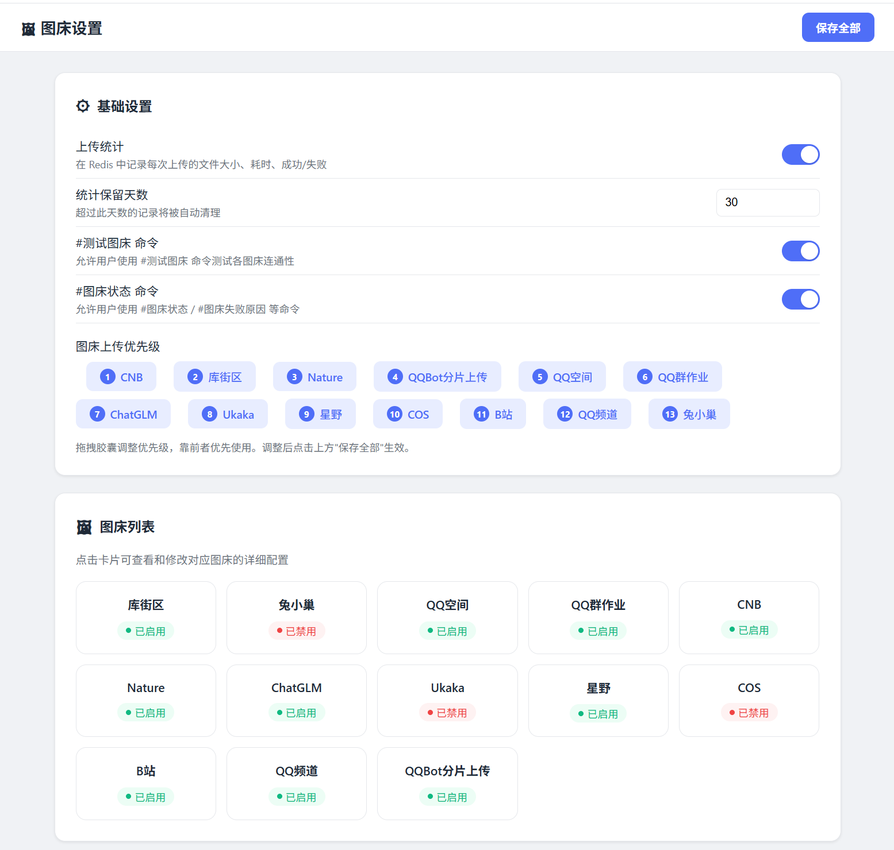
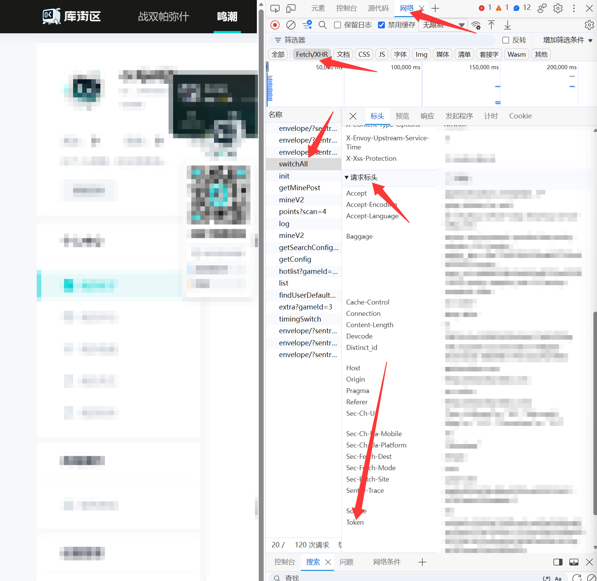
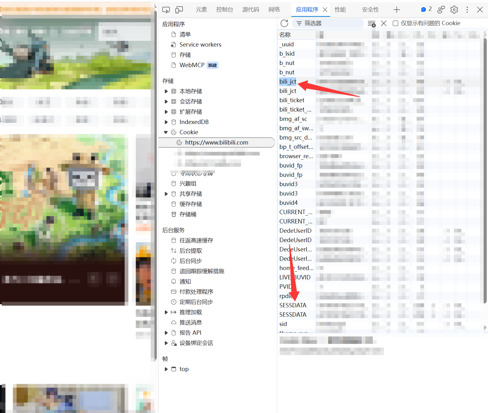

# ImageBed-Plugin

Yunzai Bot 统一图床插件 —— 为机器人提供多图床优先级链式的图片/文件上传服务，支持自动 fallback、统计记录与 Web 可视化管理。

如果使用了我的[🔗cnb图床](https://gitee.com/wind-trace-typ/cnb-image-bed)这个插件，那么请先找到`Yunzai/plugins/example/cnb图床.js`并删除，再安装本插件使用（本插件已经含有cnb图床，该插件为早期版本容易和本插件冲突）

## 功能特性

- **多图床优先级链**：按配置的优先级顺序依次尝试上报，失败自动切换下一个
- **统一 API**：注入 `Bot.imageToUrl(file, opts)`，一行调用即可将图片上行至图床并返回直链
- **自动 Fallback**：所有图床均失败时回退到 `Bot.fileToUrl`（本地临时存储）
- **Redis 统计**：记录每次上传的成功/失败、耗时、文件大小等数据
- **Web 管理面板**：可视化界面管理所有图床配置与全局设置
- **自动配置补全**：新增图床自动追加到优先级末尾，缺失字段自动补写
- **Cookie 自动获取**：QQ 空间 / QQ 群作业图床无需手动填写 Cookie

## 支持图床（14个）

| 图床 | configKey | 类型 | 需要配置 | 说明 |
|------|-----------|------|----------|------|
| CNB | `cnb` | 对象存储 | token + 仓库 | 支持广州服务器内网上传、开放平台内网访问，支持自动删除、自动清理、支持URL缓存去重，上传文件限制25MB以内，完全免费使用，100G免费空间 |
| 库街区 | `kurobbs` | 论坛图床 | token | 上传速度较快，但需要注册拿到token |
| Nature | `nature` | COS 直传 | 无（内置密钥） | 上传速度较快，但有一定上传大小限制 |
| QQBot 分片上传 | `qqbot` | 官方机器人 | bot_qq + target_openid | 使用QQBot分片上传文件，支持图片、视频、语音，上传文件限制200MB以内，腾讯云服务器在可选地域内可用内网传输，速度还可以，可做备用，其他地域或其他云服务器非内网比较慢 |
| QQ 空间 | `qzone` | QQ 空间相册 | 无（Cookie 自动获取） | 需要连接野鸡获取cookie，上传速度一般 |
| QQ 群作业 | `homework` | QQ 群作业 | 无（Cookie 自动获取） | 需要连接野鸡获取cookie，上传速度一般 |
| ChatGLM | `chatglm` | 免费图床 | 无 | 上传速度较快，但有一定上传大小限制 |
| Ukaka | `ukaka` | 免费图床 | 无 | 暂时不可用，token失效 |
| 星野 | `xingye` | 免费图床 | 无 | 上传速度较慢 |
| 腾讯云 COS | `cos` | 对象存储 | SecretId/Key + 桶 | 支持广州服务器内网上传、开放平台内网访问，支持自动删除、自动清理、支持URL缓存去重，但是需要购买各种资源包，相对CNB性价比不足 |
| B 站 | `bilibili` | 图床 | Cookie | 需要获取bilibili token |
| QQ 频道 | `qq_channel` | QQ 频道 | bot_qq + channel_id | 需要获取频道id，上传速度一般，需要发送主动消息 |
| 兔小巢 | `txc` | 兔小巢 | cookie | 暂不可用 |
| CliIm | `cliim` | 免费图床 | 无 | cli.im 免费图床，无需任何配置，返回链接为杭州oss |

## 快速开始

### 安装

在Yunzai根目录执行以下指令拉取插件：

```bash
git clone https://gitee.com/wind-trace-typ/ImageBed-Plugin.git ./plugins/ImageBed-Plugin
```

然后在执行以下指令安装依赖：

```bash
pnpm i
```

### 配置

首次启动后会在 `plugins/ImageBed-Plugin/config/` 下生成各图床的 `.yaml` 配置文件，按需填入对应凭证。

全局设置位于 `config/settings.yaml`：

```yaml
# 上传优先级（越靠前越优先，缺失的图床启动时自动补到末尾）
priority:
  - cnb
  - kurobbs
  - nature

# 统计数据
stats:
  enabled: true       # 是否启用 Redis 上传统计
  max_days: 30        # 数据保留天数

# 功能开关
apps:
  test: true          # 是否启用 #测试图床 命令
  stats: true         # 是否启用 #图床状态 等命令
```

### 代码调用

插件自动向 `Bot` 注入 `imageToUrl` 方法，其他插件可直接调用：

```js
// 上传图片 Buffer
const url = await Bot.imageToUrl(imageBuffer, { imagebed: 'cnb' })

// 不指定图床则按优先级自动选择
const url = await Bot.imageToUrl(imageBuffer)
```

若是使用此版本[🔗QQBot-Plugin](https://gitee.com/wind-trace-typ/Yunzai-QQBot-Plugin)qqbot适配器，适配器会自动调用此图床插件转换图片url做markdown图片

## 命令一览

> 所有命令仅限 **master** 权限用户，且受 `apps.test` / `apps.stats` 开关控制。

| 命令 | 功能 |
|------|------
| `#测试图床` | 生成随机 PNG 测试文件，对所有已启用图床进行逐一上传测试 |
| `#图床` | 使用消息附带或引用的图片进行上传测试 |
| `#图床状态` | 查看所有已启用图床近 1 天的统计数据 |
| `#图床状态 cnb` | 查看指定图床近 1 天的详细统计 |
| `#图床状态7天` | 查看近 7 天的统计数据 |
| `#图床状态30天` | 查看近 30 天的统计数据 |
| `#图床失败原因` | 查看近 1 天所有图床的失败原因汇总（Top 15） |
| `#图床失败原因 cnb` | 查看指定图床的失败原因 |
| `#图床失败原因30天` | 查看近 30 天的失败原因 |
| `#清空CNB图床` | 一键清空 CNB 仓库的所有远端资源 + 本地缓存 |

## Web 管理面板

- 当前可以配合[🔗qqbot-web-adapter插件](https://gitee.com/wind-trace-typ/QQBot-Web-Adapter)直接在网页端快捷设置，具体参考下图：


## 依赖

| 依赖 | 用途 |
|------|------|
| `cos-nodejs-sdk-v5` | 腾讯云 COS SDK |
| `file-type` | 检测文件 MIME 类型 |
| `image-size` | 获取图片尺寸（COS 图床用） |
| `node-schedule` | CNB 缓存定时清理（可选） |

## 目录结构

```
ImageBed-Plugin/
├── index.js                 # 插件入口
├── apps/
│   ├── stats.js             # 状态 / 失败原因查询
│   └── testHosting.js       # 图床测试
├── config/                  # 各图床配置文件 (YAML)
├── lib/
│   ├── base.js              # 基类 / 工具 / 配置加载 / 统计
│   └── *.js                 # 各图床实现
└── webadapter/
    ├── index.js             # Web 管理后台 API
    └── setting.html         # Web 管理面板前端
```

## QQBot适配器适配情况

- 如果是TRSS Yunzai + 我改版的[🔗QQBot-Plugin](https://gitee.com/wind-trace-typ/QQBot-Plugin),那么无需修改就可支持自动使用此图床插件

- 如果是Miao-Yunzai + Lain-Plugin适配器，也无需修改本身就支持自动使用本插件

- 如果是TRSS Yunzai + 原版TRSS QQBot-Plugin,那么需要找到以下位置（大概在`Yunzai/plugins/QQBot-Plugin/index.js`的第139行左右，部分版本可能因为更新行数位置不同,找到`makeMarkdownImage`函数对应位置即可）

```js
136  async makeMarkdownImage(data, file, summary = "图片") {
137    if (sharp) file = await this.compressImage(data, file)
138    const buffer = await Bot.Buffer(file)
139    const image = (await this.makeBotImage(buffer)) || { url: await Bot.fileToUrl(file) }
140
141    if (!image.width || !image.height)
142      try {
143        const size = imageSize(buffer)
144        image.width = size.width
145        image.height = size.height
146      } catch (err) {
147        Bot.makeLog("error", ["图片分辨率检测错误", file, err], data.self_id)
148      }
149
150    return {
151      des: `![${summary} #${image.width || 0}px #${image.height || 0}px]`,
152      url: `(${image.url})`,
153    }
154  }
```
中的139行`const image = (await this.makeBotImage(buffer)) || { url: await Bot.fileToUrl(file) }`改为

```js
const image = await this.makeBotImage(buffer) || { url: typeof Bot.imageToUrl === 'function' ? await Bot.imageToUrl(file) : await Bot.fileToUrl(file) }
```

## CNB图床配置方法

- 打开[cnb](https://cnb.cool/)并登录，登录完成点击右上角头像，点击个人设置找到访问令牌，添加访问令牌，到期时间设置永久有效，将`repo-manage`、`repo-notes`、`repo-code:rw`几项设置为读写（全开读写也行），然后创建，复制得到的令牌，然后新建一个仓库，自定义组织名和仓库名，然后将对应信息填入配置文件

## 库街区图床配置方法

- 打开[库街区](https://www.kurobbs.com/mc/home/9)并登录，登录完成按键盘`f12`选中`网络`，筛选器中选择`Fetch/XHR`，然后点击右上角头像，进入个人中心，刚刚f12弹出页面内会出现很多网络请求，随便点击一个，然后在`标头`选项里找到`请求标头`，里面有`Token`（如果没找到换一个链接，大部分都带Token），复制出来，然后填入配置文件。具体如下图


## QQBot分片上传配置方法

- 打开Yunzai日志，然后在群里艾特这个Yunzai上挂载的官机发送一条信息，然后在日志中找到该记录，如下图：

其中第一个红框为`Bot QQ`，第二个红框为`目标群openid`，第三个红框为`目标用户openid`，将如果选中目标类型为`user`,那么在配置文件中填入`Bot QQ`和`目标用户openid`，如果选中目标类型为`group`,那么在配置文件中填入`Bot QQ`和`目标群openid`，然后在`文件类型`中填入`auto`即可

## B站图床配置方法

- 打开[B站](https://www.bilibili.com/)并登录，然后按`f12`选中`应用程序`，然后`找到Cookie`，选中`https://www.bilibili.com`的Cookie，然后找到`bili_jct`、`sessdata`的值填入配置文件即可，如下图:


## QQ频道图床配置方法

- 打开Yunzai日志，然后选中一个Bot有主动消息权限的文字子频道，艾特这个Yunzai上挂载的官机发送一条信息，然后在日志中找到该记录，如下图：

其中第一个红框为`Bot QQ`，第二个红框为`channel_id`，将其填入配置文件即可

## 问题反馈

- [🔗内部交流群 1095352740](https://qm.qq.com/q/JxYAlbKRGy)反馈
- 邮箱459521475@qq.com反馈
- 直接提issue反馈(可能不会及时看到)